**[Visitar el repositorio del proyecto en GitHub](https://git.generalassemb.ly/joeynavarro/Submissions/tree/master/Projects/ACT%20Against%20SAT)**

## Planteamiento del problema {#problem-statement}

Entre 2017 y 2018 se registraron cambios en las tasas de participación de los exámenes SAT y ACT. Este informe explora las razones de esos cambios en Estados Unidos, con los datos clasificados por examen y materia.

## Resumen ejecutivo {#executive-summary}

### Importación y limpieza de los datos de 2017 {#2017-data-import--cleaning}

Se corrigieron errores, como caracteres adicionales, y se eliminaron los signos de porcentaje para convertir todos los datos numéricos en números decimales.

### Importación y limpieza de los datos de 2018 {#2018-data-import-and-cleaning}

Se comprobó que los datos coincidían con los campos del conjunto de 2017. Los datos depurados de 2017 y 2018 se combinaron en un único DataFrame para facilitar la comparación.

### Análisis exploratorio de datos {#exploratory-data-analysis}

Se calculó la desviación estándar de cada variable numérica mediante tres métodos diferentes. También se identificaron los estados con los valores más altos y más bajos en las tasas de participación y las puntuaciones.

### Visualización de datos {#data-visualization}

Se utilizaron histogramas, diagramas de caja, mapas de calor y diagramas de dispersión para profundizar en el análisis de los datos y sus correlaciones.

Las figuras originales se conservan sin modificaciones; los rótulos integrados en las imágenes permanecen en inglés.

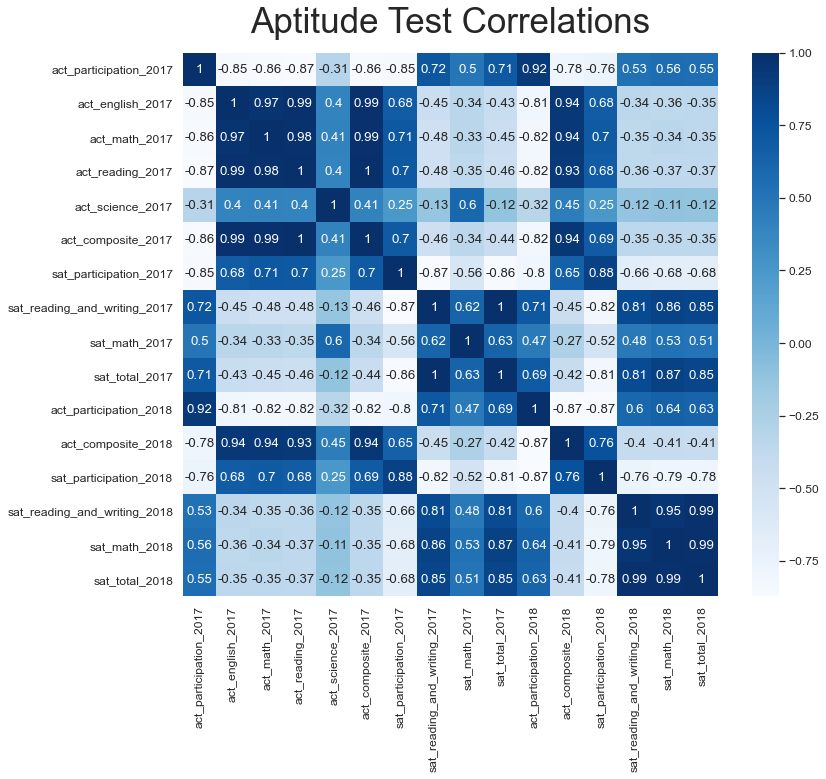

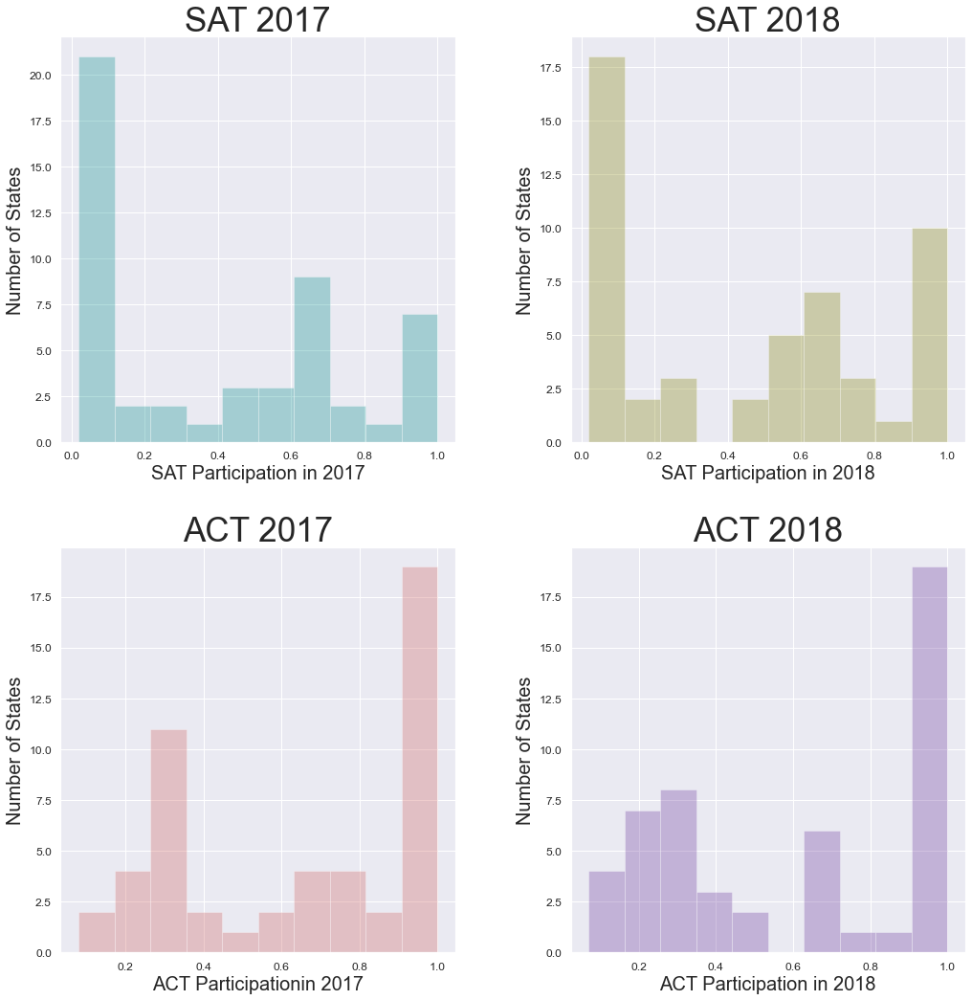

| Visualizaciones del análisis | Visualizaciones del análisis |
| --- | --- |
| 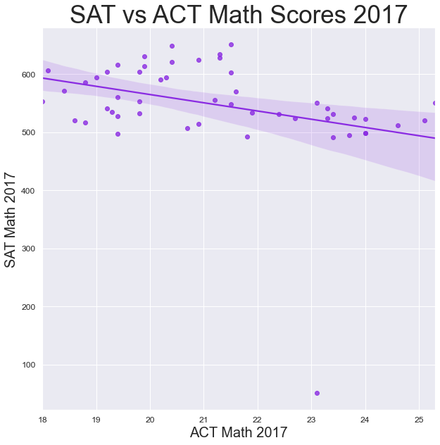 | 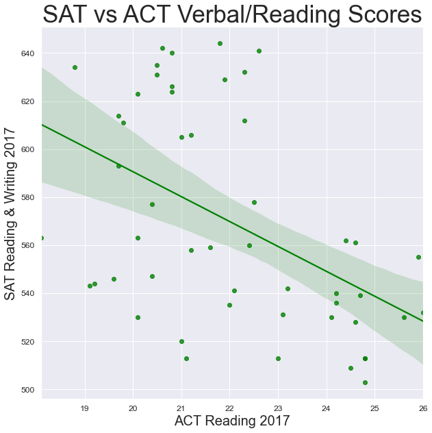 |
| 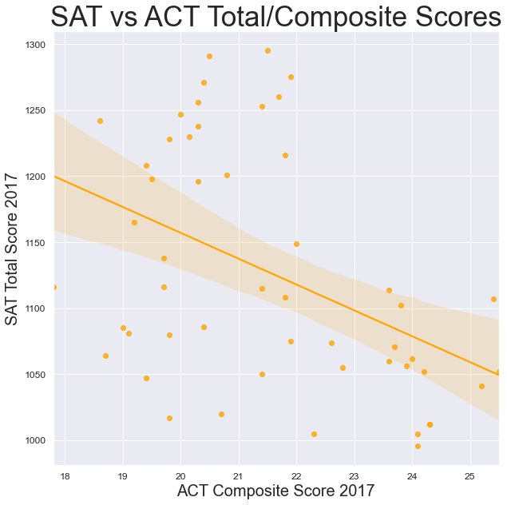 | 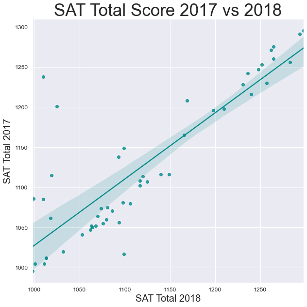 |
| 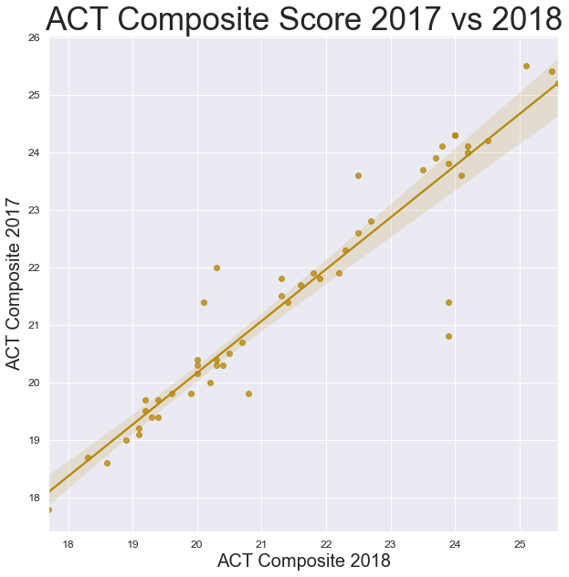 | |
| 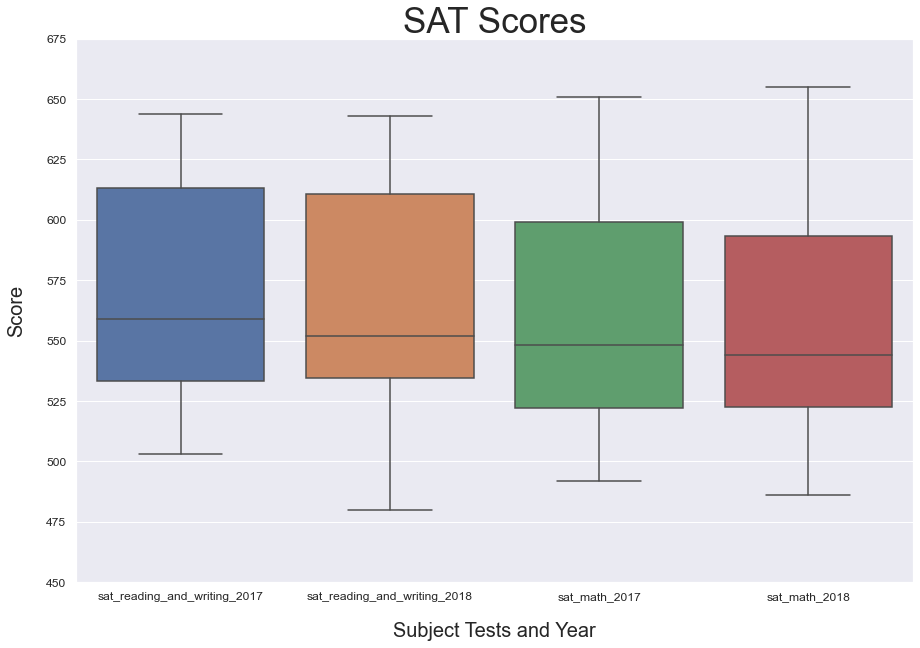 | 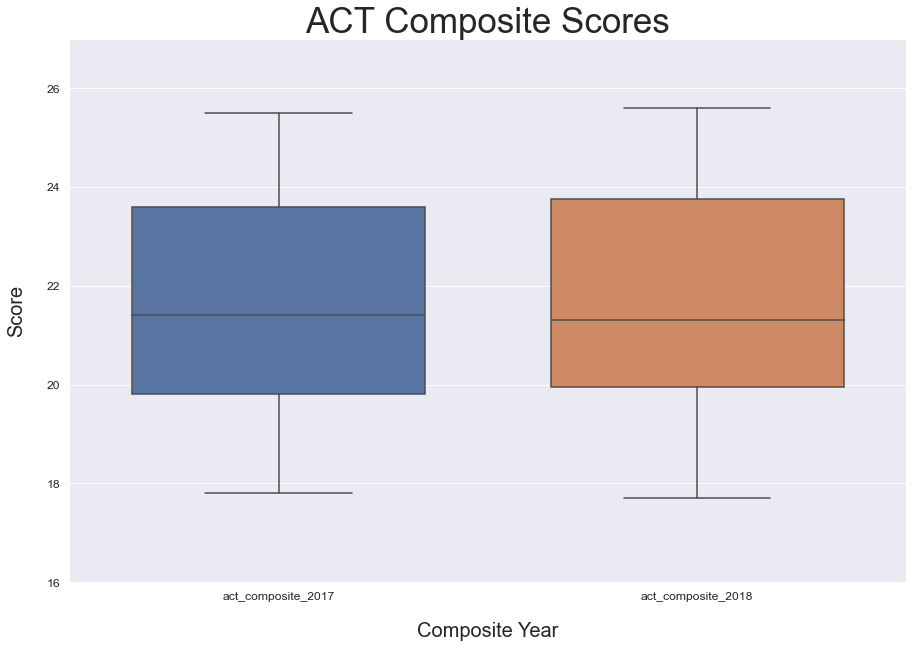 |
| 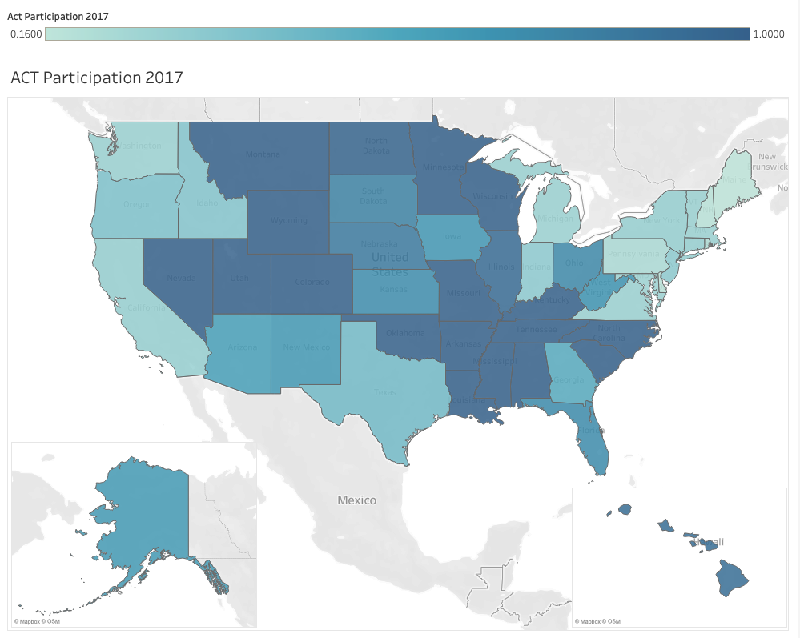 | 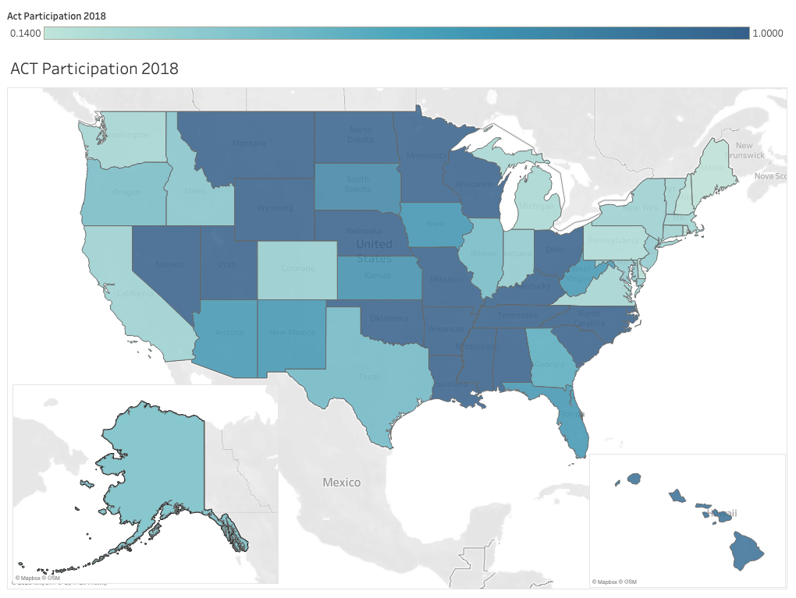 |
| 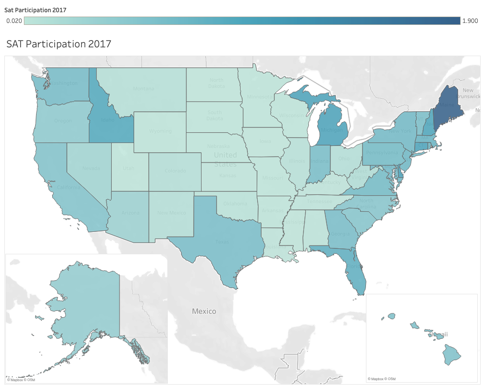 | 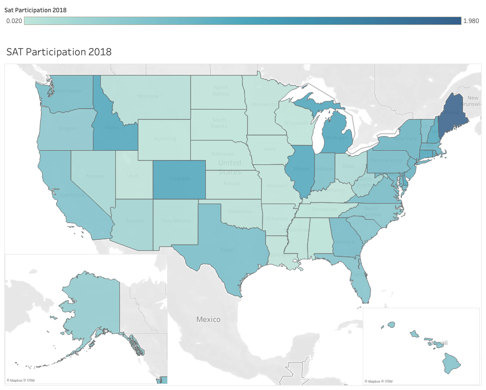 |

### Estadística descriptiva e inferencial {#descriptive-and-inferential-statistics}

La mayoría de las estadísticas presenta una distribución aproximadamente normal. Aunque hay más de 30 observaciones, disponer de más datos ayudaría a que las variables numéricas utilizadas en este informe se acercaran aún más a una distribución normal.

### Investigación externa {#outside-research}

Se consultó información de los departamentos de educación estatales y otros artículos relacionados. Algunas de esas fuentes describen las políticas estatales sobre la presentación obligatoria de los exámenes o la cobertura de las cuotas de inscripción.

### Conclusiones y recomendaciones {#conclusions-and-recommendations}

Los departamentos de educación estatales desempeñan un papel fundamental en el aumento de las tasas de participación. Esto puede lograrse mediante subsidios estatales para los exámenes o al hacerlos obligatorios para todos los estudiantes. Virginia Occidental, Ohio, Rhode Island e Illinois son ejemplos de estados cuyas políticas tuvieron un efecto considerable en las tasas de participación del SAT. El SAT Test Day, que se celebra durante un día escolar habitual, también contribuyó al aumento de la participación general en ese examen.

Concentrarse en la colaboración con los departamentos de educación estatales, las universidades y las escuelas secundarias probablemente contribuiría a que las tasas de participación del SAT siguieran aumentando.

Se puede investigar más sobre los criterios de admisión de las universidades de Estados Unidos, los centros donde se presenta el SAT y su utilización, para comprender mejor cómo seguir impulsando la participación.

