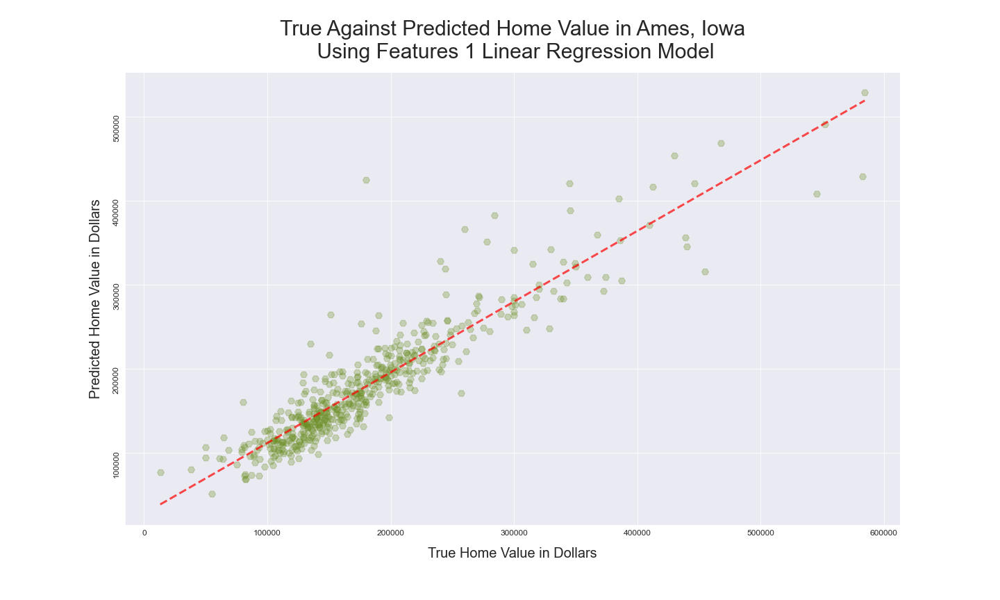
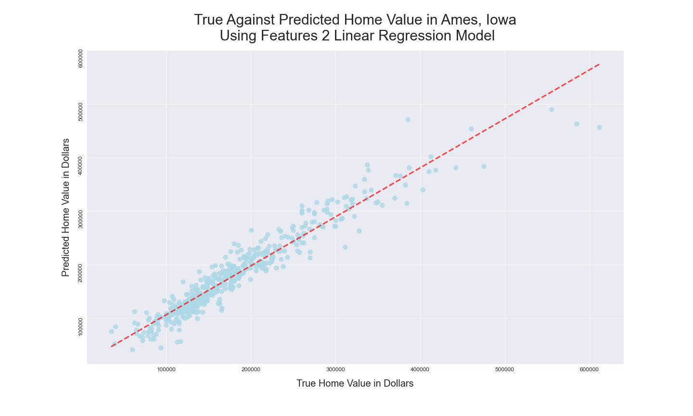
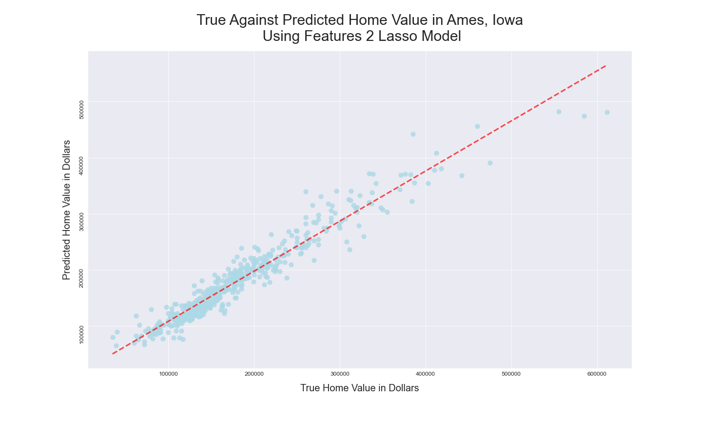
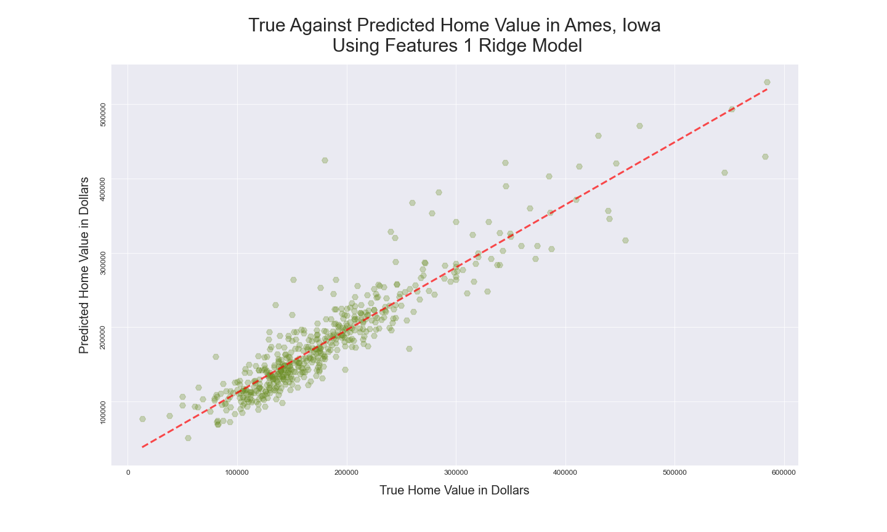
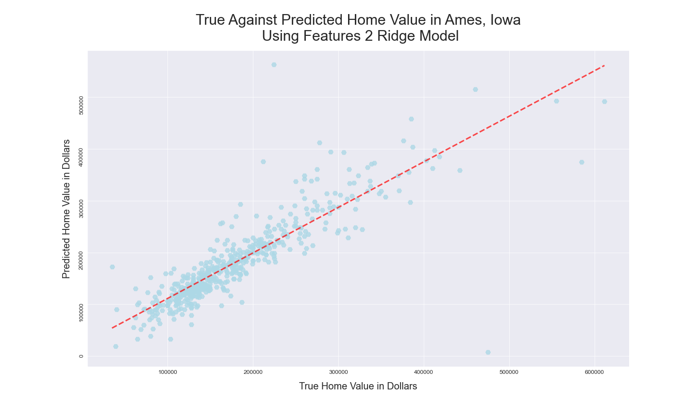

**[Visitar el repositorio del proyecto en GitHub](https://git.generalassemb.ly/joeynavarro/Submissions/tree/master/Projects/Ames%2C%20IA%20Sale%20Price%20Predictions)**

## Planteamiento del problema {#problem-statement}

Utilizar los datos de viviendas de Ames de 2006 a 2010 para construir un modelo de regresión lineal que prediga los precios de las viviendas con la mayor precisión posible, con 82 características de las viviendas disponibles para seleccionar e incorporar al modelo.

## Resumen ejecutivo {#executive-summary}

El propósito de este proyecto era predecir los precios de las viviendas en Ames, Iowa, a partir de un conjunto de datos de la oficina del asesor de impuestos inmobiliarios de Ames con información sobre viviendas vendidas entre 2006 y 2010. El [diccionario de datos y la información del conjunto se encuentran aquí](http://jse.amstat.org/v19n3/decock/DataDocumentation.txt). Mi reto consistía en construir un modelo de regresión lineal que predijera los precios con la mayor precisión posible, con 80 características de las viviendas disponibles para seleccionar e incorporar al modelo.

Estas fueron las decisiones principales que tomé durante el proceso de modelado:

**1. Reemplazar los valores nulos por 0:** No eliminé columnas con una cantidad considerable de valores nulos. Al examinar esas columnas, descubrí que la mayoría no representaba información faltante; contenían «NA» porque la vivienda no tenía esa característica, como una piscina. No consideré necesario tratar de forma distinta las columnas categóricas y numéricas al reemplazar los valores nulos por 0, ya que finalmente convertí los datos categóricos en variables indicadoras.

**2. Eliminar valores atípicos:** Tanto el diccionario de datos como los subgráficos de las columnas de datos nominales ofrecieron pistas sobre los valores atípicos. Graficar el precio de venta frente a la superficie habitable sobre el nivel del suelo y la superficie del terreno permitió delimitar los datos del conjunto. Según el diccionario de datos, era probable que los valores atípicos correspondieran a ventas parciales inusuales de propiedades grandes. Decidí eliminarlos para mejorar la predicción de los precios de la mayoría de las viviendas, y esto mejoró las puntuaciones del modelo.

**4. Selección de variables:** Utilicé dos conjuntos de variables. En el primero, solo incluí aquellas que, según una prueba de hipótesis de mínimos cuadrados ordinarios (OLS), influían en el precio de venta. En el segundo, utilicé todas las variables numéricas y creé un DataFrame de variables indicadoras para las características nominales y ordinales; después lo concatené con los DataFrames de entrenamiento y prueba. También modifiqué otras variables; por ejemplo, convertí el año de construcción en una década y la traté como categórica. Sin embargo, en general no eliminé variables del modelo. Escalé todas las variables, pero solo utilicé variables polinómicas en el modelo LASSO del segundo conjunto.

**5. Normalización de variables:** Al graficar la distribución de los precios de venta, observé una marcada asimetría positiva que afectaría la asimetría de los residuos. Para los modelos del primer conjunto de variables, apliqué el logaritmo natural a `saleprice`. Después de generar las predicciones, revertí esa transformación con `np.exp` para volver a expresarlas como precios de venta. No normalicé la distribución de `saleprice` en el segundo conjunto de variables. En ambos conjuntos, apliqué el logaritmo natural a la superficie del primer piso, cuya distribución también presentaba asimetría positiva.

**6. Regresión lineal, LASSO y Ridge:** Decidí utilizar regresión lineal, LASSO y Ridge para los dos conjuntos de variables seleccionados, con el fin de explorar los mejores resultados posibles de R2. A continuación se muestran las puntuaciones de validación cruzada para ambos conjuntos:

#### Conjunto de variables 1 {#features-1}

```
=================================Linear Regression Trainning Model==================================
R2 accuracy scores: [0.8143551  0.8561741  0.85683833 0.78311332 0.8468853 ]
Mean R2 accuracy percentage score: 83.15%
======================================= LASSO Trainning Model=======================================
R2 accuracy scores: [0.81370306 0.8562642  0.85549358 0.78330549 0.84813553]
Mean R2 accuracy percentage score: 83.14%
====================================== Ridge Trainning Model =======================================
R2 accuracy scores: [0.81334599 0.85632417 0.85690038 0.78303623 0.84709909]
Mean R2 accuracy percentage score: 83.13%
```

#### Conjunto de variables 2 {#features-2}

```
=================================Linear Regression Trainning Model==================================
R2 accuracy scores: [0.93107482 0.90936166 0.8927695  0.92091675 0.91120928]
Mean R2 accuracy percentage score: 91.31%
====================================== Ridge Trainning Model =======================================
R2 accuracy scores: [-0.07766958 -0.0731773  -0.02480281 -0.07054359 -0.00858686]
Mean R2 accuracy percentage score: 91.36%
=======================================LASSO Trainning Model =======================================
R2 accuracy scores: [0.93183718 0.9067743  0.89368633 0.93125707 0.3766999 ]
Mean R2 accuracy percentage score: 80.81%
```

## Índice del cuaderno de análisis {#notebook-table-of-contents}

Este es el índice del cuaderno original del proyecto; las secciones detalladas se encuentran en el repositorio enlazado al comienzo del informe.

**A. Importación y análisis exploratorio de datos**

1. Importación de bibliotecas
2. Lectura de datos
3. Análisis exploratorio inicial
4. Correlaciones entre el precio de venta y las características de las viviendas
5. Identificación de columnas nominales, numéricas, ordinales y de la variable objetivo
6. Exploración de columnas numéricas
7. Exploración de la relación entre los valores nominales y el precio de venta
8. Inicio de una prueba de hipótesis para las columnas numéricas

**B. Ingeniería y selección de variables**

8. Exploración y filtrado del DataFrame para eliminar valores atípicos
9. Normalización de la distribución de una columna con asimetría hacia la derecha
10. Creación de variables indicadoras para las columnas de datos nominales

**C. Modelado, visualizaciones y predicciones**

11. Prueba, ajuste y evaluación de modelos para `Features_1`
12. Validación cruzada de modelos para el conjunto de variables 1
13. Modelo de regresión lineal para el conjunto de variables 1
14. Modelo LASSO para el conjunto de variables 1
15. Modelo Ridge para el conjunto de variables 1
16. Validación cruzada de modelos para el conjunto de variables 2
17. Prueba, ajuste y evaluación de modelos para el conjunto de variables 2
18. Modelo de regresión lineal para el conjunto de variables 2
19. Modelo Ridge para el conjunto de variables 2
20. Modelo LASSO para el conjunto de variables 2

**E. Reflexiones finales**

## Diccionario de datos y fuentes {#data-dictionary--sources}

Para el conjunto de datos de Ames, eliminé los valores atípicos recomendados en el documento de datos enlazado a continuación. También eliminé varios registros cuyo valor era poco realista en relación con el precio de la vivienda.

| Atributo final | Tipo de dato | Descripción breve |
| --- | --- | --- |
| Gr Liv Area | INT64 | Superficie habitable sobre el nivel del suelo, en pies cuadrados |
| Year Built | INT64 | Año de construcción de la vivienda |
| Overall Cond Bi | INT64 | 1 si la condición general es >= 5; de lo contrario, 0 |
| Year Remod/Add | INT64 | Año de remodelación de la vivienda |
| Tot_bath_bsmt | INT64 | Número total de baños en el sótano |
| Lot Area | INT64 | Superficie del terreno |
| Sale Type Bi | INT64 | 1 si es 'New'; 2 si es 'Oth' o 'CWD'; de lo contrario, 0 |
| Outdoor Liv Area | INT64 | Suma de las superficies de la terraza de madera, el porche abierto y el porche con mosquitero: Wood Deck SF + Open Porch SF + Screen Porch |
| Bldg Type Bi | INT64 | 1 si es '1fam' o 'TwnhmE'; de lo contrario, 0 |
| TotRms AbvGrd | INT64 | Número total de habitaciones sobre el nivel del suelo |
| Mo Sold | INT64 | Mes de la venta |
| Yr Sold | INT64 | Año de la venta |
| Tot_bath_abv_grd | INT64 | Número total de baños sobre el nivel del suelo |
| Kitchen AbvGr | INT64 | Número de cocinas sobre el nivel del suelo |
| Bedroom AbvGr | INT64 | Número total de dormitorios sobre el nivel del suelo |

Consultar los siguientes sitios:

* **[Diccionario de datos del conjunto original](http://jse.amstat.org/v19n3/decock/DataDocumentation.txt)**
* **[Fuente de los datos](https://www.kaggle.com/c/dsi-us-6-project-2-regression-challenge)**

### Resultados de los mejores modelos {#best-model-results}

#### Conjunto de variables 1 {#features-1-1}

```
===========================Linear Regression Model Prediction Statistics============================
R2 for Linear Regression Prediction: 0.8700234972388585
MSE for this Linear Regression model is: 686366622.7770644
RMSE for this Linear Regression model is: 26198.59963389388

=================================LASSO Model Prediction Statistics==================================
Lasso Predicted R2:0.8706816416380891
MSE for this LASSO model is: 682891161.1435899
RMSE for this LASSO model is: 26132.186306231437

=================================Ridge Model Prediction Statistics==================================
R2 for this Ridge Prediction :0.8703364117573583
MSE for this Ridge model is: 684714215.7902782
RMSE for this Ridge model is: 26167.044460356585
```

#### Conjunto de variables 2 {#features-2-1}

```
===========================Linear Regression Model Prediction Statistics============================
R2 for Linear Regression Prediction: 0.9206366157181036
MSE for this Linear Regression model is: 499113738.4875931
RMSE for this Linear Regression model is: 22340.85357562672

=================================LASSO Model Prediction Statistics==================================
R2 for this LASSO Prediction: 0.9308087194010227
MSE for this LASSO model is: 435141709.78186566
RMSE for this LASSO model is: 20860.050569973835

=================================Ridge Model Prediction Statistics==================================
R2 for this Ridge Prediction :0.9206067964317198
MSE for this Ridge model is: 499301271.0082985
RMSE for this Ridge model is: 22345.050257457435


```

### Visualizaciones de los resultados de los mejores modelos {#best-model-result-visualizations}

Las figuras y las salidas de los modelos se conservan en su forma original, incluidos sus rótulos en inglés y las cifras reportadas. La traducción no recalcula ni corrige los resultados del informe de 2020.

| Conjunto de variables 1 | Conjunto de variables 2 |
| --- | --- |
|  |  |
|  |  |
|  |  |

### Conclusiones y próximos pasos {#conclusions--next-steps}

La regresión LASSO, junto con algunas transformaciones de datos, la eliminación de valores atípicos extremos y la creación de variables indicadoras, me permitió ajustar un modelo que alcanzó un valor de R2 de 0.93. Los próximos pasos consisten en intentar predecir los precios exactos. Para ello, podría probar modelos más avanzados o utilizar métodos de clasificación para seleccionar las variables.

